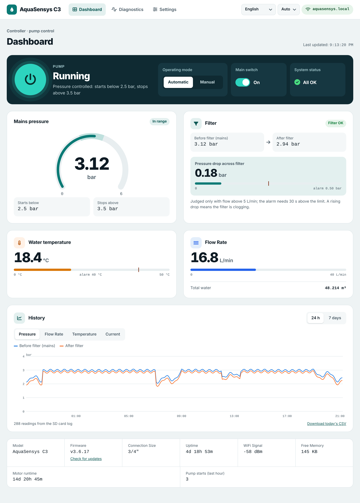
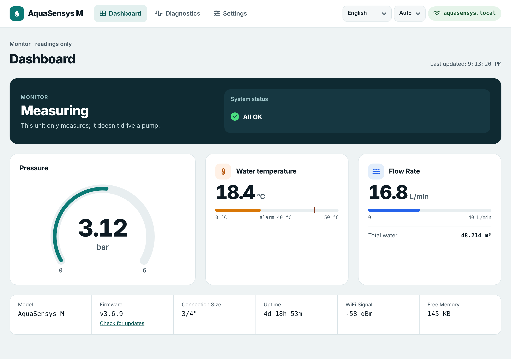
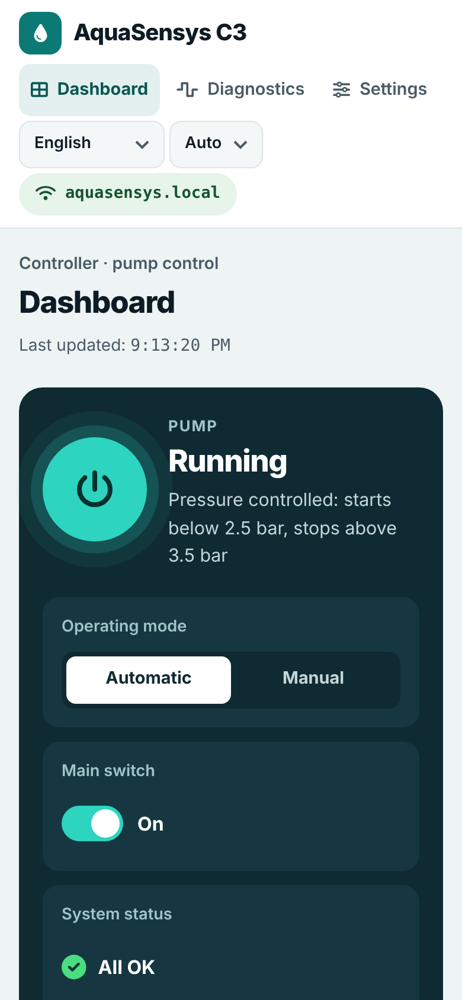
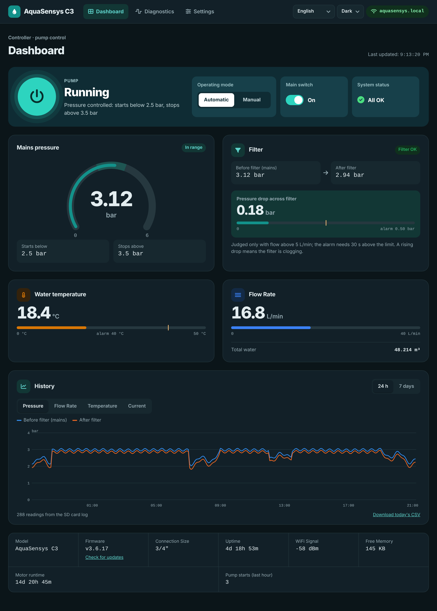
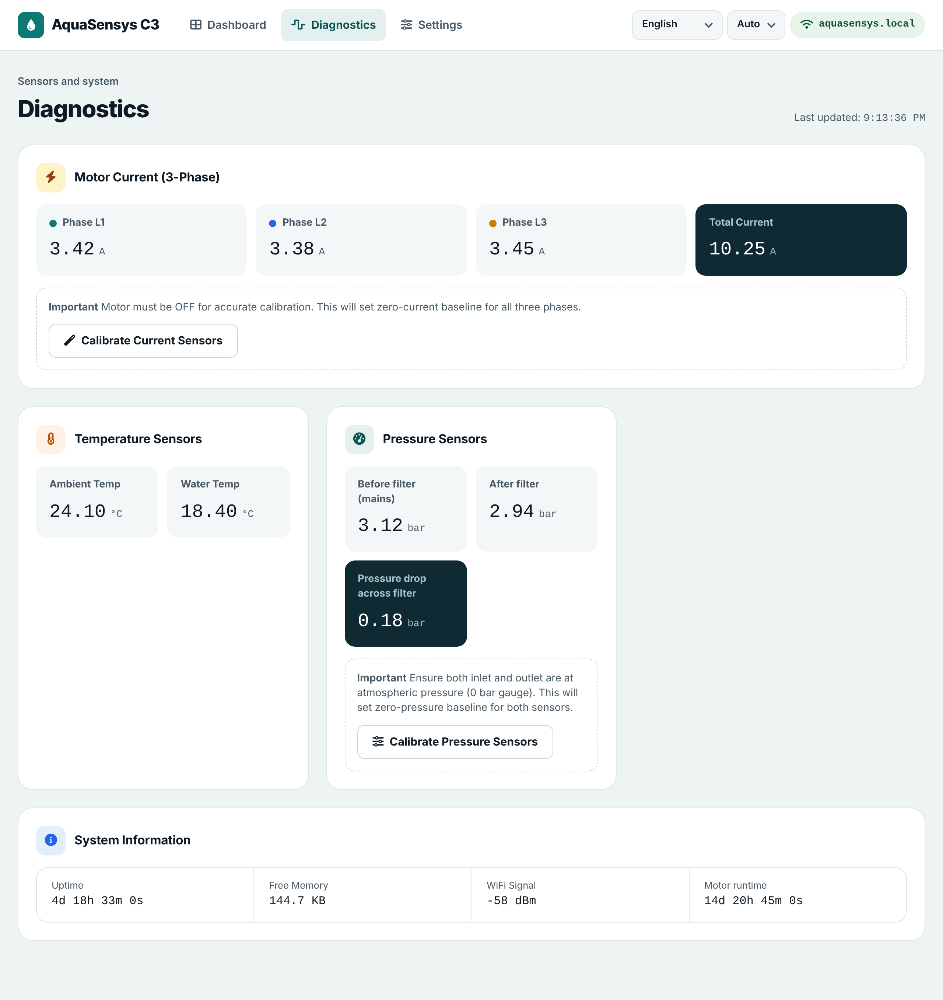
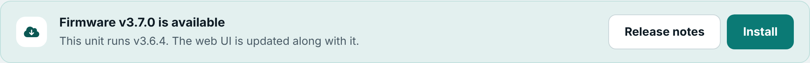
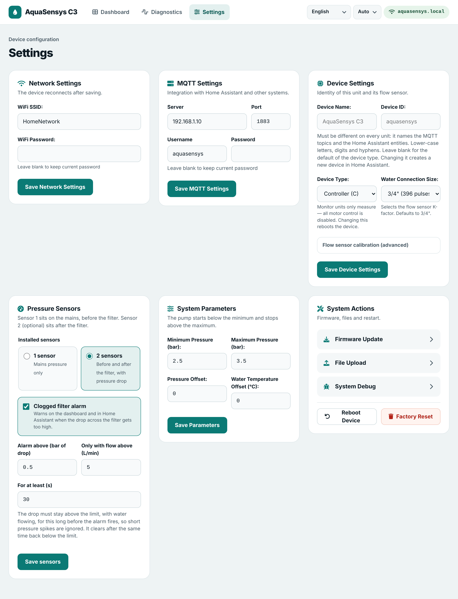

# 💧 AquaSensys

**Smart monitoring and pump control for your water supply.**

Pressure, flow, temperature and pump current in real time, on your phone,
your computer and in Home Assistant, plus automatic protection for the pump.

---

## Why AquaSensys?

A booster pump or a well pump usually fails without warning. It runs dry,
it overheats, a filter clogs, a phase drops out. Most of the time nobody knows
until the taps run dry. AquaSensys sits on the water line and watches the
whole system for you:

- **See what your water is doing.** Live pressure, flow and water temperature,
  from any browser on your network. Nothing to install.
- **Protect the pump.** It shuts the pump down on dry running, overcurrent,
  phase imbalance and out-of-range pressure, before any damage is done.
- **Know when to change the filter.** With a second pressure sensor it
  measures the drop across the filter and warns you when it starts to clog.
- **Fits into your smart home.** It appears in Home Assistant on its own, with
  every sensor, switch and alarm ready for dashboards and automations.
- **Keeps itself up to date.** New firmware is announced on the dashboard and
  installed with one click.

## Two models

| | **AquaSensys C3**: Controller | **AquaSensys M**: Monitor |
|---|:---:|:---:|
| Pressure, flow and water temperature | ✅ | ✅ |
| Clogged-filter alarm (second pressure sensor) | ✅ | ✅ |
| 3-phase motor current measurement | ✅ | ✅ |
| Home Assistant integration | ✅ | ✅ |
| Automatic updates | ✅ | ✅ |
| **Pump control** (starts and stops on pressure) | ✅ | — |
| **Pump protection** (dry run, overcurrent, phase imbalance) | ✅ | — |
| Automatic / manual mode and main switch | ✅ | — |
| Pump runtime counter | ✅ | — |

The **Controller** replaces a traditional pressure switch: it drives the pump
and protects it. The **Monitor** only measures, for systems that already
have their own control, or for keeping an eye on a second line.

Both run the same firmware. A unit's model, its pipe size (3/4" or 1") and
its name are settings, so a Monitor can become a Controller later.

---

## A closer look

### Dashboard: everything at a glance

The dashboard opens at `http://aquasensys.local` (or the unit's IP address)
and updates every second. On a Controller the top panel shows the pump and
its controls: **automatic** mode (it starts below the minimum pressure and
stops above the maximum), **manual** mode for priming or maintenance, and the
**main switch**.

On a **Monitor**, the motor controls are gone and the readings come first:

### History

The dashboard charts the pressure, flow, water temperature and motor current
over the last day or week, straight from the logs on the unit's SD card: no
Home Assistant or internet needed. Point at any moment to see its values.

### Clogged-filter alarm

With a second pressure sensor after the filter, AquaSensys shows the pressure
on both sides and the **drop across the filter**. As the filter clogs, the drop
rises. Past the limit you set (0.5 bar by default) the dashboard and Home
Assistant raise an alarm. It is only judged while water is flowing, and must
last a while before it fires, so pressure spikes don't cause false alarms.

### Leak alarm

A dripping tap, a running cistern or a burst pipe never let the water stop.
AquaSensys raises a **leak alarm** when the water hasn't stopped for an hour,
or, if you like, when water runs for a few minutes during the night. On a
Controller it can also stop the pump. The alarm shows on the dashboard and in
Home Assistant, and clears by itself once the water stops.

### On your phone, day or night

Every page works on a phone, and comes in **English and Portuguese** with a
**light and a dark theme**. The theme follows your device by default.

  
  &nbsp;&nbsp;
  

### Pump protection

On a Controller, these faults stop the pump straight away and keep it stopped
until someone checks the system:

| Fault | When it trips |
|---|---|
| **Dry run** | The pump runs for 10 s with no water flowing |
| **Overcurrent** | Total motor current above the limit (15 A by default) |
| **Phase imbalance** | The three phases differ by more than 3 A |
| **Pressure out of range** | Below 1 bar or above 5 bar |

The electrical faults stay active even in manual mode. Whoever is running
the pump, the motor stays protected.

Each fault is its own alarm in Home Assistant, so a notification can say
exactly what happened. AquaSensys also counts the pump's starts: a pump that
**short-cycles** (starts too often, usually a pressure tank that has lost its
air) raises a warning, or, if you choose, stops the pump.

### Diagnostics

The current in each of the three motor phases, both temperatures (water and
ambient), both pressures and the state of the unit itself. You can also
calibrate the current and pressure sensors from here with one click.

### Home Assistant

AquaSensys announces itself to Home Assistant through MQTT. Point it at your
broker and every entity appears on its own, with nothing to set up in YAML:

- **Sensors**: pressure (inlet / outlet), filter pressure drop, flow rate, total water,
  water temperature, WiFi signal and uptime.
- **Switches** (Controller): pump, main switch, manual mode.
- **Alarms**: one per cause (dry run, overcurrent, phase imbalance, pressure
  out of range, short cycling), clogged filter and water leak, plus an overall
  system fault.
- **Energy dashboard**: the total water used goes straight into *Water
  consumption*, and the flow rate can be shown as the water flow, both with
  long-term statistics. The total is counted by the unit and kept on its SD
  card, so it survives restarts and Home Assistant being down.
- **Updates**: new firmware shows up under *Settings → Updates*, ready to
  install from Home Assistant.

If a unit goes offline, Home Assistant shows it as *unavailable* within
about 25 seconds instead of showing old readings as if they were current.

### One-click updates

The unit checks for new firmware twice a day. When a new version is out, the
dashboard says so. Press **Install** and the unit downloads it, verifies it,
updates both the firmware and the web interface, and restarts. Nothing is
installed until you ask, and if a download fails the unit keeps running the
version it had.

### Settings

WiFi, MQTT, pressure limits, sensors, alarms and the time zone are all set
from the browser. Nothing needs reprogramming. An optional **password**
protects every change, while the readings stay open to anyone at home.

---

## Getting started

1. **Install** the module on the water line: pressure sensor(s), flow sensor,
   temperature probe and, on a Controller, the pump contactor and current
   sensors.
2. **Power it on.** With no WiFi set up yet, it creates its own network,
   `AquaSensys-XXXXXXXXXXXX`. Connect to it and open `http://192.168.4.1`.
3. **Enter your WiFi** (and, optionally, your MQTT broker for Home Assistant).
   The unit restarts and joins your network.
4. **Open `http://aquasensys.local`** and set the pressure limits for your
   installation. That's it.

Running several units? Give each one its own **Device ID** under
*Settings → Device Settings*, so their Home Assistant entities stay separate.

## Technical specifications

| | |
|---|---|
| Controller | ESP32, WiFi 2.4 GHz |
| Pressure | 1 or 2 sensors, 0–5 bar (0.5–4.5 V) |
| Flow | Hall-effect flow sensor, 3/4" or 1" connection |
| Temperature | Water and ambient |
| Motor current | 3 phases, measured separately (ACS712) |
| Analog inputs | 12-bit external ADC (MCP3208) |
| Storage | microSD card: settings, web interface and logs |
| Status light | RGB LED: healthy, pump running, fault |
| Integrations | Web dashboard, MQTT, Home Assistant (auto-discovery), mDNS |
| Updates | Over the air, from GitHub releases, with checksum verification |

---

## Documentation

- **[Technical reference](docs/REFERENCE.md)**: every setting in `config.json`,
  calibration, protection rules, Home Assistant entities and the update process.
- **[Changelog](CHANGELOG.md)**: what changed in each firmware version.

## License

[MIT](LICENSE)
